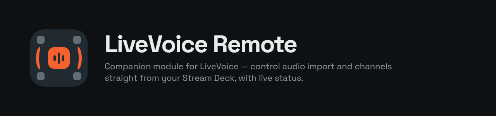

<p align="center">
  
</p>

<p align="center">
  <a href="https://github.com/meyer-productions/companion-module-livevoice/actions/workflows/node.yaml">
    
  </a>
  <a href="./LICENSE.md">
    
  </a>
  <a href="./companion/manifest.json">
    
  </a>
</p>

# LiveVoice Remote

A [Bitfocus Companion](https://bitfocus.io/companion) connection module for [LiveVoice](https://livevoice.io) -
controls audio import start/stop and reads real-time status directly over LiveVoice's internal HTTP +
ActionCable WebSocket interface. No browser, no Selenium, no PowerShell helper scripts.

> «LiveVoice» und das LiveVoice-Logo sind Marken der LiveVoice GmbH. Dieses Projekt ist ein unabhängiges
> Community-Modul, steht in keiner Verbindung zu LiveVoice und verwendet weder deren Logo noch deren Wortmarke
> als Produktname. Der Operator-Link wird ausschliesslich lokal in der Companion-Instanz gespeichert; es werden
> keine Audio-Daten, Event-Daten oder Zugangsdaten an Dritte übertragen.

## Features

- **One-field setup** - paste the LiveVoice operator link; API key, client identifiers, join code and
  event/channel info are all read automatically from the loaded operator page.
- **Long-lived ActionCable connection** with automatic reconnect/backoff and ping/pong keep-alive.
- **Actions** - Start Import, Stop Import, and Toggle Import (toggles only on an unambiguous server state, never
  guesses).
- **Feedbacks driven by the real server state** - active / inactive / offline / unknown, plus connection status
  and a listener-count comparator. Never inferred from the last command sent.
- **Variables** for event, channel, connection status, import state and listener count.
- **Ready-made presets** with the module's own key-style graphics, wired to the actions above.

Full reference for configuration, actions, feedbacks, variables and presets: [companion/HELP.md](./companion/HELP.md).
Protocol reverse-engineering notes: [INFO.md](./INFO.md).

## Installation

1. Download the latest `.tgz` package from the [Releases](../../releases) page (or build it yourself, see
   below).
2. In Companion, go to **Modules → Import module package** and select the downloaded file.
3. Add a new "LiveVoice Remote" connection and paste your LiveVoice operator link into **Operator-Link**.

## Known limitation

Companion does not currently carry a preset's own feedbacks over onto a button when the "LiveVoice Start &
Stop" preset is dragged onto it - the button's Feedbacks tab stays empty even though the preset defines them
correctly (elements and action steps _do_ transfer). This is a confirmed, currently open Companion bug -
[bitfocus/companion#4410](https://github.com/bitfocus/companion/issues/4410) - not a defect in this module.
Details and the exact one-time manual workaround are documented in
[companion/HELP.md](./companion/HELP.md#bekannte-einschränkung-stand-30082026-bestätigt-auf-companion-504).

## Development

This project uses TypeScript, [@companion-module/base](https://github.com/bitfocus/companion-module-base) and
Yarn 4.

```sh
yarn install       # install dependencies
yarn build         # compile once to dist/
yarn dev           # compile in watch mode
yarn test          # run the protocol unit tests (HTML discovery, ActionCable framing, state parsing)
yarn lint          # eslint
yarn package       # build + produce the importable .tgz via companion-module-build
```

## Brand assets

[assets/brand/](./assets/brand/) contains the module's icon/logo/lockup set (colors, typography and usage in
[README-Assets.md](./assets/brand/README-Assets.md)) - open [preview.html](./assets/brand/preview.html) locally
to review all vector variants. `social-preview-1280x640.png` is uploaded under this repo's
**Settings → General → Social preview**.

## License

[MIT](./LICENSE.md)
